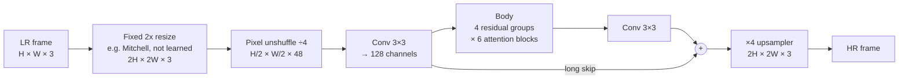
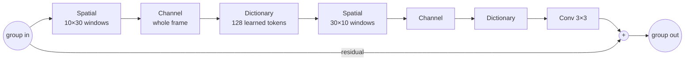
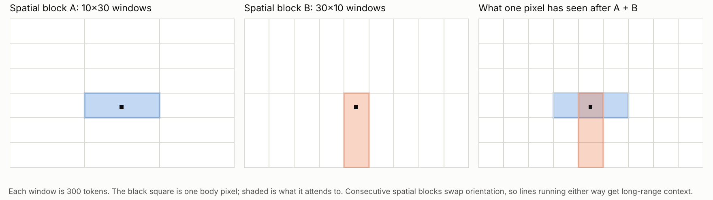
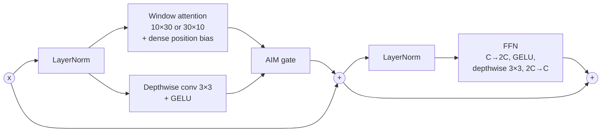
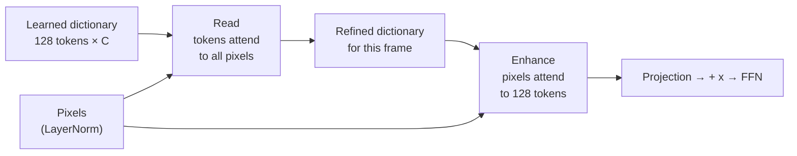

# FDAT-RD3

**FDAT-RD3 is a 2x super-resolution transformer for restoring animation (and other content) from
DVD / LaserDisc-grade sources to HD.** It takes a degraded low-resolution frame and outputs a clean
frame at twice the width and height. It was designed around one practical target: real-time-class
video upscaling through TensorRT, with static ONNX export and deterministic output.

On an RTX 4080, the medium model upscales 720×540 video to 1440×1080 at **18 fps** in a real
VapourSynth pipeline (encoding included), and its TensorRT engine alone runs at **49.8 ms per
frame**. In a controlled benchmark it matches the quality of FDAT, the transformer it descends from,
at 1.6× FDAT's speed, and beats ESRGAN on quality at about the same speed.

| 2x, 720×540 → 1440×1080, RTX 4080 | **FDAT-RD3** (medium) | FDAT (medium) | ESRGAN (64nf/23) |
|---|---|---|---|
| Real-world fps (VapourKit + TensorRT, with encode) | **18** | 11 | 17 |
| Quality, ANIMEFILM L1 benchmark: PSNR / TOPIQ-FR | 27.06 / 0.801 | **27.09 / 0.803** | 26.86 / 0.793 |
| Parameters | 7.8M | 4.6M | 16.7M |

This repository has the network for [traiNNer-redux](https://github.com/the-database/traiNNer-redux)
(training), a standalone ONNX converter (deployment), a [spandrel](https://github.com/chaiNNer-org/spandrel)
package (chaiNNer and other spandrel hosts), a TensorRT profiler, training configs, and the benchmark data.

---

## Contents

1. [The architecture in one picture](#1-the-architecture-in-one-picture)
2. [Design choices, and why](#2-design-choices-and-why)
3. [The parts in detail](#3-the-parts-in-detail)
4. [Built for TensorRT](#4-built-for-tensorrt)
5. [Results: FDAT-RD3 vs FDAT vs ESRGAN](#5-results-fdat-rd3-vs-fdat-vs-esrgan)
6. [Using it](#6-using-it)
7. [Limitations](#7-limitations)
8. [Family and naming](#8-family-and-naming)

---

## 1. The architecture in one picture



The frame is first enlarged 2x with a **fixed** resize kernel, then folded back down with a 4×4
pixel unshuffle. The transformer **body therefore works at half the input resolution** (a 720×540
frame becomes a 360×270 feature map), which is what makes it fast. A ×4 upsampler takes the body's
output back to the 2x target size.

The body is 4 residual groups. Each group cycles through three kinds of attention block, twice:



| Block | What it lets a pixel look at | Cost |
|---|---|---|
| **Spatial** | Its neighbours inside a 10×30 (or 30×10) window: local detail and line continuity | linear in pixels |
| **Channel** | Every pixel in the frame, summarised per feature channel: global colour/tone statistics | linear in pixels |
| **Dictionary** | 128 learned "typical structure" tokens, refreshed from the current frame: a global prior | linear in pixels |

Every block also has a depthwise-conv branch and a convolutional feed-forward network, so local
texture never depends on attention alone. The medium model has 24 blocks (8 of each kind), 128
channels and 4 attention heads.

## 2. Design choices, and why

**Work at half resolution.** Self-attention cost grows with the number of pixels. Running the body
at LR/2 means a quarter of the pixels of a native-resolution body, roughly a 3–4x speed-up.
The pixel unshuffle that does this is a lossless rearrangement (each body pixel carries the 4×4
patch it came from as channels), and on DVD-grade sources very little real detail exists below
2-pixel scale anyway: chroma is subsampled and the composite / MPEG chain has already removed it.

**Resize before the body, not after.** The input is upsampled with a fixed, center-aligned kernel
before the unshuffle, so the network corrects an image that is already on the output pixel grid
rather than inventing sub-pixel positions from scratch. This came from an observation in earlier
model pairs: 1x models run on pre-resized frames were temporally steadier than 2x models on the same
material (less frame-to-frame wobble, most visible on static shots and scrolling text), for a small
cost in still-frame PSNR. The resize is not learned, costs one small convolution, and bit-matches
VapourSynth's `resize.*` so a model behaves the same in any pipeline. The body still runs at LR/2,
so it costs nothing in speed.

**Rectangular, alternating windows.** Cel animation is dominated by long, thin lines. A square
window gives a line the same short reach in every direction; a 10×30 window gives it long reach
along one axis, and the next spatial block flips to 30×10 so both orientations are covered:



Both window shapes also **tile the production resolution exactly**: a 720×540 frame gives a
360×270 body, and both 360 and 270 are multiples of 30, so no compute is wasted on padding.

**Global context three cheap ways.** Windows alone can't see across the frame. The channel and
dictionary blocks add frame-wide context while staying linear in the number of pixels and
fixed-shape, so they export cleanly:
- *Channel attention* (as in Restormer's MDTA) compares feature channels using statistics gathered
  over the whole frame. It is cheap and good at global tone and colour consistency.
- *Dictionary attention* (the deployable part of ATD) keeps a learned bank of 128 structure tokens.
  The bank first reads the current frame, then every pixel reads the bank. The intent is a learned
  prior for structures that recur across cel animation (line endings, eyes, hair, flat-fill edges)
  that a window can't see enough of on its own.

**Mix attention with convolution.** Each spatial and channel block runs a depthwise 3×3 conv branch
in parallel with its attention and merges the two through a small learned gate (AIM). In spatial
blocks, channel statistics of the conv branch scale the attention output; in channel blocks, a
per-pixel map from the attention output scales the conv branch. The feed-forward network also
contains a depthwise 3×3 conv, so every block mixes neighbouring pixels.

**A dense position bias, kept on purpose.** Each spatial window learns a full 300×300 bias per head
(about 2.9M of the medium model's 7.8M parameters). A compact Swin-style relative bias table was
tried and reverted: the dense bias measurably helped on hard frames (thin lineart, eyes, small
chroma detail).

**Deployment rules from the start.** No data-dependent control flow, static shapes, no
`ConvTranspose` or other ops that fall back to FP32 in BF16 engines, and pixel (un)shuffle written
as explicit reshapes. Section 4 covers the graph-level work this involved.

## 3. The parts in detail

Shapes below are for a 720×540 input and the medium model (C = 128, 4 heads of 32 channels).

### Stem

```
LR  540×720×3  →  fixed 2x resize  →  1080×1440×3
                →  reflect-pad to a multiple of 120  →  pixel unshuffle 4  →  270×360×48
                →  conv 3×3  →  270×360×128   (x_shallow)
```

The resize kernel is chosen when the model is built (`resize_kernel: mitchell | bicubic |
catmull_rom | spline16 | spline36 | spline64 | lanczos`), stored in the checkpoint
(`pre.MetaResize`), and checked on load. The single up-front pad aligns the body to the 30-pixel
window grid at *any* input size, so the per-block window pads are always no-ops and there are no
seams; the output is cropped back at the end.

An alternative `stem: unshuffle` skips the resize and unshuffles the LR frame by 2 instead. It
gives the same body size and exists to load FDAT-RD 2x checkpoints.

### Spatial block



Windows are 300 tokens on a fixed grid (no shifting). Information crosses window borders through
the depthwise convs, the alternating orientation, and the two global block types. The AIM gate here
multiplies the attention output by a channel gate computed from the conv branch (global average
pool → 1×1 reduce 8× → GELU → 1×1 → sigmoid) and adds the conv branch.

### Channel block

Same layout as the spatial block, with the window attention replaced by **transposed attention**:
per head, a 32×32 attention matrix *between channels* is computed from cosine similarities of the
q and k channels over every pixel of the frame, scaled by a learned per-head temperature. Each
output channel is a frame-aware mix of the input channels. The AIM gate is the mirror image: a
per-pixel sigmoid map from the attention output scales the conv branch.

### Dictionary block



Both steps are ordinary multi-head attention with a fixed number of tokens, so cost is linear in
the number of pixels and the shapes are static. Dictionary blocks have no conv branch or gate: their
job is the global prior, and the neighbouring blocks already do local mixing.

### Upsampler

From the body (270×360×128) to the output (1080×1440×3), ×4:

```
ConvTranspose 4×4 stride 2 (128→128) → GELU → ConvTranspose 4×4 stride 2 (128→3) → Conv 3×3 (3→3)
```

A 4×4, stride-2 transpose conv already avoids the classic checkerboard pattern, and the trailing
3×3 conv smooths what's left. In the deployed graph each transpose conv is computed as ordinary
convolutions (section 4); the weights are stored as transpose convs.

### Where the parameters and compute go

Medium model, one 720×540 frame:

| Component | Params | Share | GMAC | Share | Engine time (BF16 per-layer profile, approx.) |
|---|---|---|---|---|---|
| FFNs (24) | 1.63M | 21% | 158 | 28% | 13.1 ms |
| Spatial attention (8) | 3.41M | 44% | 111 | 19% | 4.8 ms |
| Dictionary attention (8) | 1.05M | 14% | 102 | 18% | 10.2 ms |
| Channel attention (8) | 0.53M | 7% | 89 | 16% | 2.8 ms |
| Group-end and body-end convs | 0.74M | 10% | 72 | 13% | in "glue" |
| Upsampler | 0.27M | 4% | 31 | 5% | 1.7 ms |
| Stem, gates, norms | 0.16M | 2% | 7 | 1% | in "glue" |
| Layout, LayerNorm and other glue | | | | | ~10 ms |
| **Total** | **7.77M** | | **570** | | **49.8 ms end to end** |

Most parameters are the dense window position biases, which cost almost nothing to run. Most time
is the FFNs and the dictionary's "read" step (8 passes, each 128 queries against 97,200 pixels).

### Sizes

| Variant | Channels | Heads | Groups | Dictionary tokens | Blocks | Params | GMAC @ 720×540 |
|---|---|---|---|---|---|---|---|
| `fdat_rd3_small` | 96 | 3 | 4 | 64 | 24 | 4.92M | 326 |
| `fdat_rd3_medium` | 128 | 4 | 4 | 128 | 24 | 7.77M | 570 |
| `fdat_rd3_large` | 192 | 6 | 6 | 256 | 36 | 22.45M | 1,841 |

All use 10×30 windows (fixed), FFN expansion 2, AIM reduction 8. Medium is the tested and
recommended size.

## 4. Built for TensorRT

The network above can be written in more than one mathematically identical way, and TensorRT is
sensitive to which. The straightforward implementation of this exact network builds a 61.0 ms BF16
engine on an RTX 4080 at 720×540. FDAT-RD3's graph builds a **49.8 ms** engine from the same weights.
Three rewrites account for the difference, and none changes the output beyond floating-point noise.

**Transpose convs as plain convs: 6.6 → 1.7 ms.** VapourKit's BF16 TensorRT build finds no BF16
kernel for `ConvTranspose2d(k=4, s=2, p=1)`, so it runs both upsampler layers in FP32 and inserts
conversions around them. FDAT-RD3 computes each transpose conv exactly with ordinary convolutions
and a depth-to-space step:
- 128→128: four 2×2 convs, one per output sub-pixel phase (same arithmetic as the transpose conv).
- 128→3: one 3×3 conv to 12 channels, then depth-to-space (one read of the input; the extra
  arithmetic on a 3-channel output is trivial).

The derived kernels are baked as constants at export (`freeze_for_export()`); training and
checkpoints keep the `ConvTranspose2d` parameters.

**Channel attention folded into one matrix: 9.2 → 2.8 ms.** The textbook form normalises q and k
over ~97k pixels, multiplies full-resolution tensors twice and projects. FDAT-RD3 instead builds one
small 256×256 Gram matrix of `[q | k]` over the pixels, takes the cosines and per-head softmax on
that, and folds attention, value projection and output projection into **a single 128×128 matrix**
applied once. The value tensor is never materialised. q and k are pre-scaled by N^-½, which turns
the Gram matrix into a mean and keeps it inside FP16 range at full-frame pixel counts.

**Attention scale order: −1.7 ms.** The graph computes `(q @ kᵀ) * scale`, the pattern TensorRT's
fused-attention matcher looks for, instead of `(q * scale) @ kᵀ`. Training uses PyTorch's SDPA and
is unaffected. `--attn-scale pre` exports the other order for comparison.

**The rest of the deployment checklist.** Pixel (un)shuffle as explicit reshape/permute
(`nn.PixelUnshuffle` mis-exports to ONNX and desaturates the output), one up-front pad instead of
per-block dynamic padding, no data-dependent branches, legacy TorchScript exporter at opset 17.

| Engine, 720×540, RTX 4080, TensorRT 11.2.1 | Straightforward graph | FDAT-RD3 graph |
|---|---|---|
| End-to-end latency, BF16 | 61.0 ms (16.4 fps) | **49.8 ms (20.1 fps)** |
| Upsampler | 6.6 ms | 1.7 ms |
| Channel attention | 9.2 ms | 2.8 ms |
| FP32 conversion layers | 1.5 ms | 0 |
| Real-world VapourKit fps, with encode | 15–16 | **18** |

FP16 is not faster (51.1 ms): the dictionary step doesn't change and FP16 adds about 8 ms of
layout conversions. **Deploy in BF16.**

The exported medium graph has 2,865 ONNX nodes (77 Conv, 192 MatMul, 32 Softmax, no
ConvTranspose) and is 32.6 MB in fp32.

**Verified equivalence.** Max |difference| in fp32, random weights, 90×120 input (deliberately not
window-aligned):

| Check | Max difference |
|---|---|
| FDAT-RD3 graph vs straightforward graph, same weights | 5.1×10⁻⁷ |
| FDAT-RD 2x checkpoint loaded into FDAT-RD3 (`stem: unshuffle`) vs FDAT-RD | 2.0×10⁻⁷ |
| Exported ONNX (onnxruntime) vs PyTorch, full 720×540 frame | 4.2×10⁻⁷ |

## 5. Results: FDAT-RD3 vs FDAT vs ESRGAN

**Setup.** Each network trained from scratch on the same anime film dataset (ANIMEFILM, paired
HR/LR, 2x) with only an L1-type loss (Charbonnier), so the architecture is the only real variable.
Batch 16, seed 42, AdamW 2e-4, learning rate halved at 100k / 125k / 150k / 175k, EMA 0.999,
200k iterations. All three reduce resolution at the front (FDAT and ESRGAN by plain pixel
unshuffle). Scores are traiNNer's validation on 5 held-out images (EMA weights, 4-px border crop, RGB).
TOPIQ-FR is a learned full-reference perceptual metric (higher is better).


### Quality at 200k

| | PSNR (dB) | SSIM | TOPIQ-FR |
|---|---|---|---|
| FDAT | **27.093** | **0.8844** | **0.8028** |
| FDAT-RD3 | 27.064 (−0.03) | 0.8840 (−0.0004) | 0.8011 (−0.002) |
| ESRGAN | 26.856 (−0.24) | 0.8774 (−0.007) | 0.7931 (−0.010) |

| Iteration | FDAT | FDAT-RD3 | ESRGAN |
|---|---|---|---|
| 25k | 25.55 / 0.739 | 25.55 / 0.739 | 25.32 / 0.727 |
| 50k | 26.27 / 0.772 | 26.21 / 0.768 | 25.88 / 0.753 |
| 100k | 26.82 / 0.789 | 26.75 / 0.792 | 26.32 / 0.774 |
| 150k | 27.05 / 0.801 | 27.00 / 0.799 | 26.72 / 0.791 |
| 200k | 27.09 / 0.803 | 27.06 / 0.801 | 26.86 / 0.793 |

(PSNR dB / TOPIQ-FR. Every 5k step: [`docs/data/animefilm_l1_val.csv`](docs/data/animefilm_l1_val.csv).)

### Speed


| 720×540 → 1440×1080, RTX 4080 | FDAT-RD3 | FDAT | ESRGAN |
|---|---|---|---|
| Real-world fps (VapourKit + TensorRT 11, with encode) | **18** | 11 (13 on TensorRT 10) | 17 |
| ms per frame, real-world | **≈56** | ≈91 | ≈59 |
| TensorRT engine, BF16 / FP16 | 49.8 / 51.1 ms | not profiled | not profiled |
| GMAC per frame | 570 | 444 | 1,743 |
| Parameters | 7.77M | 4.56M | 16.70M |
| Training speed / peak VRAM (batch 16) | ~6.4 it/s / 7.2 GB | ~5.5 it/s / 9.9 GB | ~5.7 it/s / 9.5 GB |

### What it says

- **Against FDAT: same quality, 1.6× faster.** The gaps (0.03 dB, 0.002 TOPIQ) are smaller than a
  5-image validation set can resolve, and the curves cross repeatedly (FDAT-RD3 led on TOPIQ at
  100k). FDAT-RD3 also trained on 120-px crops against FDAT's 128 px, which if anything favours FDAT.
- **Against ESRGAN: better at about the same speed.** +0.21 dB, +0.007 SSIM, +0.008 TOPIQ, ahead
  from 15k onwards. ESRGAN does 3× the arithmetic but is pure convolution, which TensorRT runs very
  efficiently; FDAT-RD3's time goes to attention and memory traffic instead.
- **FDAT is slow for its arithmetic:** fewest operations of the three, slowest in practice. That's
  graph and memory overhead, the kind section 4 removed.

### Caveats

- 5-image validation set: gaps under ~0.15 dB between these models are ties.
- Confounds: FDAT-RD3 used 120-px crops (the others 128 px); ESRGAN trained with FP16 mixed
  precision, the others BF16.
- FDAT and ESRGAN engine latency wasn't profiled; their speed is the real-world VapourKit figure.
- An L1-only benchmark ranks architectures. It doesn't predict perceptual quality after GAN
  fine-tuning, and it doesn't measure temporal stability.

## 6. Using it

### Repository layout

```
traiNNer/fdat_rd3_arch.py          network for traiNNer-redux (FDATRD3, fdat_rd3_small/medium/large)
onnx_tools/fdat_rd3_converter.py   standalone converter: ONNX export, checkpoint port, --info
spandrel/FDATRD3/                  spandrel / chaiNNer package
tools/profile_trt.py               per-layer TensorRT profiler using VapourKit's engine builder
options/2x_FDATRD3_L1.yml          L1 pretraining config (the benchmark recipe)
options/2x_FDATRD3_GAN.yml         GAN fine-tune config
docs/                              benchmark data and the scripts that draw the figures
```

The network code is identical in all three places; only the registration differs.

### Train (traiNNer-redux)

Copy `traiNNer/fdat_rd3_arch.py` into `traiNNer-redux/traiNNer/archs/` (it's picked up
automatically), then start from `options/2x_FDATRD3_L1.yml` with your dataset paths.

```yaml
scale: 2
amp_bf16: true
network_g:
  type: fdat_rd3_medium
  resize_kernel: mitchell     # the tested default
  # use_checkpoint: true      # trade speed for training VRAM
datasets:
  train:
    lq_size: 120              # any multiple of 60 avoids window padding
```

- **Crop size.** The body is LR/2 and windows need multiples of 30, so use LR crops that are
  multiples of 60 (120 gives a 60×60 body).
- **Precision.** BF16. The network is FP16-safe, but BF16 is what's tested and deployed.
- **GAN fine-tune.** `options/2x_FDATRD3_GAN.yml` starts from the L1 model (U-Net discriminator;
  MS-SSIM, perceptual, HSLuv, focal-frequency and GAN losses).
- **FDAT-RD checkpoints** (2x, unshuffle) load directly with `stem: unshuffle`.

### Export to ONNX / TensorRT

`onnx_tools/fdat_rd3_converter.py` is self-contained: the network is embedded, and it needs only
`torch` and `safetensors` (plus `onnx` and `onnxruntime` for the built-in check). It reads the
size, stem and resize kernel from the checkpoint.

```bash
python fdat_rd3_converter.py model.safetensors                        # static 720×540 input, verified
python fdat_rd3_converter.py model.safetensors --input-size 1080 1440 # H W of the LR input
python fdat_rd3_converter.py model.safetensors --info                 # just print the detected config
python fdat_rd3_converter.py old.safetensors -f safetensors           # write a native FDAT-RD3 checkpoint
```

Formats: `onnx-static` (default), `onnx-dynamic`, `safetensors`, `pth`. Each export prints a graph
summary and an onnxruntime-vs-PyTorch check.

Recommended path: fp32 static ONNX from the converter → VapourKit (vs-mlrt) → BF16 TensorRT
engine built at load time. Use one static ONNX per source resolution; any H×W works because the
network pads and crops internally.

### chaiNNer / spandrel

`spandrel/FDATRD3/` uses spandrel's internal imports, so it goes inside spandrel's own
`architectures/` folder:

1. Copy it to `<site-packages>/spandrel/architectures/FDATRD3/`.
2. Register it in `spandrel/__helpers/main_registry.py`
   (`ArchSupport.from_architecture(FDATRD3.FDATRD3Arch())` plus the import), or at runtime:

```python
from spandrel import MAIN_REGISTRY, ArchSupport
from spandrel.architectures.FDATRD3 import FDATRD3Arch
MAIN_REGISTRY.add(ArchSupport.from_architecture(FDATRD3Arch()))
```

Files are recognised by their `MetaFDATRD3` marker and load as a 2x model that supports FP16 and
BF16, tagged e.g. `['128dim', 'stem-resize', 'pre-mitchell', 'medium']`. FDAT-RD's spandrel package
can be installed alongside; neither claims the other's files.

### Profile an engine

`tools/profile_trt.py` builds the engine with VapourKit's own TensorRT builder (same precision
handling as deployment) and reports end-to-end latency plus time per model component. Run it with
VapourKit's Python:

```bat
<VapourKit>\data\vapoursynth-portable\python.exe tools\profile_trt.py ^
    --vk-data <VapourKit>\data --onnx model_rd3_static_540x720.onnx --bf16
```

It writes `summary.txt`, `layers.csv`, `profile.json` and `engine_info.json` next to the ONNX.

## 7. Limitations

- **The dictionary "read" step is the biggest remaining cost** (~10 ms, ~20% of the frame).
  TensorRT fuses it, but 128 queries against ~97k keys gives fused kernels too little to
  parallelise. Pooling the keys would save ~5 ms but changes the model, so it was left out.
- **2x only**, and the 10×30 window size is fixed (it isn't stored in checkpoints).
- **No FP16 speed-up**; deploy in BF16.
- **Temporal stability isn't benchmarked here yet.** The pre-resize stem is motivated by steadier
  video in earlier experiments; a direct frame-to-frame comparison against FDAT and ESRGAN is still
  to be run.
- **No pretrained weights are published yet.**

## 8. Family and naming

```
FDAT        windowed spatial + channel attention, AIM gates          github.com/stinkybread/FDAT
 └─ FDAT-RD   + rectangular alternating windows (R)
              + learned token dictionary (D)                         github.com/stinkybread/FDAT-RD
     └─ FDAT-RD3   + fixed pre-resize stem, TensorRT-oriented graph   this repository
```

FDAT-RD3 keeps FDAT-RD's body and adds the pre-resize stem and the deployment graph. An
intermediate version with only the pre-resize stem was used internally and never released, which is
why the version number skips. FDAT-RD3 files carry their own `MetaFDATRD3` marker so they never
clash with FDAT or FDAT-RD files in spandrel or traiNNer, and the unrelated square-window `FDAT3`
in traiNNer is a different network.
