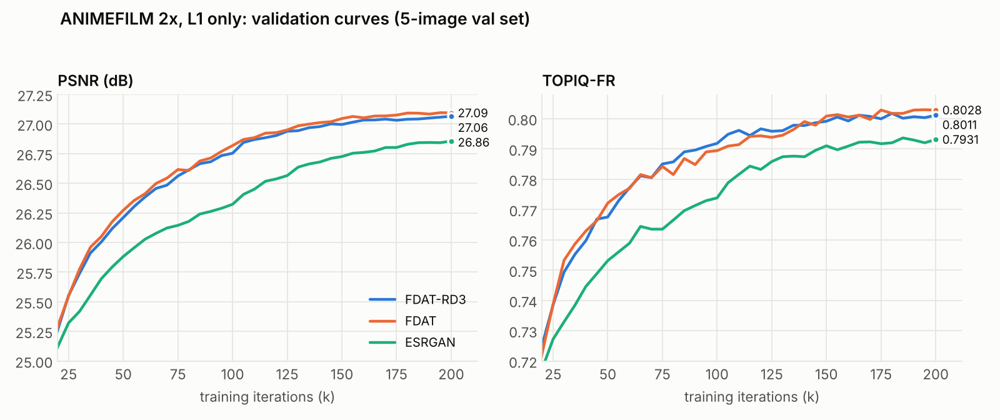
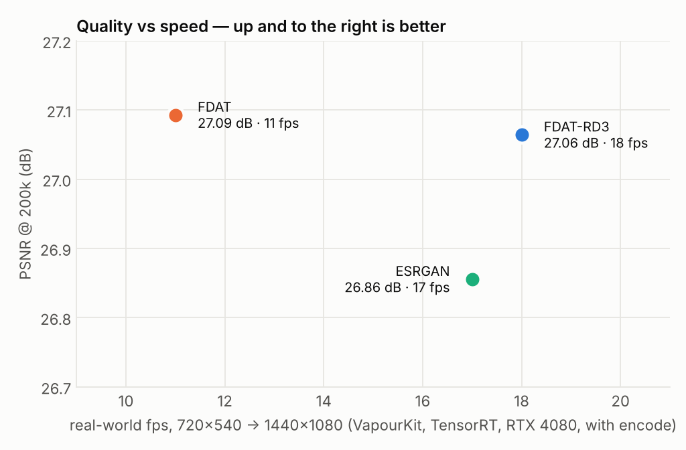

# FDAT-RD3

`fdat_rd3` is **FDAT-RD2 with an inference-optimised graph**. It computes the same function with the
same weights, but its ONNX graph is rewritten where TensorRT was losing time. On an RTX 4080 the
TensorRT 11 BF16 engine drops from **61.0 ms to 49.8 ms per 540×720 frame** (16.4 → 20.1 fps), and
real-world VapourKit throughput goes from 15–16 to **18 fps**. Quality is unchanged: an FDAT-RD or
FDAT-RD2 checkpoint loads directly and produces the same output to within 5×10⁻⁷.

It targets the same job as the rest of the family: animation (and other) super-resolution from
DVD/LD-grade sources to HD, deployed as a static ONNX through TensorRT (VapourSynth / VapourKit).

| 2x, 540×720 → 1080×1440 | **FDAT-RD3** (medium) | FDAT (medium_aligned) | ESRGAN (64nf/23) |
|---|---|---|---|
| Real-world fps, RTX 4080 (VapourKit, TensorRT, with encode) | **18** | 11 | 17 |
| TensorRT engine latency, BF16 | **49.8 ms** | not profiled | not profiled |
| Compute per frame | 570 GMAC | 444 GMAC | 1,743 GMAC |
| Parameters | 7.77M | 4.56M | 16.70M |
| PSNR @ 200k, ANIMEFILM L1 | 27.064 | **27.093** | 26.856 |
| SSIM @ 200k | 0.8840 | **0.8844** | 0.8774 |
| TOPIQ-FR @ 200k | 0.8011 | **0.8028** | 0.7931 |
| Training speed (it/s, batch 16) | **~6.4** | ~5.5 | ~5.7 |
| Training peak VRAM | **7.2 GB** | 9.9 GB | 9.5 GB |

**In short:** FDAT-RD3 matches FDAT on quality (−0.03 dB, inside the noise of a 5-image validation
set) at 1.6× FDAT's speed, and beats ESRGAN by +0.21 dB PSNR / +0.008 TOPIQ while also running
slightly faster on a third of ESRGAN's arithmetic. Benchmark setup and caveats are
[below](#benchmark-fdat-rd3-vs-fdat-vs-esrgan).





---

## Contents

- [Lineage](#lineage)
- [What changed in RD3](#what-changed-in-rd3)
- [Equivalence: same function, same weights](#equivalence-same-function-same-weights)
- [Stems](#stems)
- [Variants](#variants)
- [Repository layout](#repository-layout)
- [Training (traiNNer-redux)](#training-trainner-redux)
- [Export to ONNX / TensorRT](#export-to-onnx--tensorrt)
- [chaiNNer / spandrel](#chainner--spandrel)
- [Profiling](#profiling)
- [Benchmark: FDAT-RD3 vs FDAT vs ESRGAN](#benchmark-fdat-rd3-vs-fdat-vs-esrgan)
- [Limitations and what's left](#limitations-and-whats-left)

## Lineage

```
FDAT        https://github.com/stinkybread/FDAT
 └─ FDAT-RD   rectangular alternating 10×30 windows + 128-token dictionary attention
              https://github.com/stinkybread/FDAT-RD
     └─ FDAT-RD2   fixed, zimg-exact 2x pre-resize in front of the body (steadier video)
         └─ FDAT-RD3   same network, TensorRT-optimised graph   ← this repo
```

The body is FDAT-RD's: residual groups cycling **spatial** (rectangular windowed self-attention,
10×30 / 30×10 alternating), **channel** (transposed, MDTA-style) and **dictionary** (cross-attention
against a learned 128-token bank, ATD-derived) blocks. Spatial and channel blocks fuse a depthwise
conv branch through an AIM gate; every block ends in a depthwise-mix FFN. The tail is FDAT-RD's
×4 "transpose+conv" upsampler. See the [FDAT-RD README](https://github.com/stinkybread/FDAT-RD)
for the reasoning behind each piece.

FDAT-RD2 added a **fixed 2x pre-resize** (a non-learned, center-aligned kernel that bit-matches
VapourSynth's `resize.*`) ahead of an unshuffle-4 stem. The body still runs at LR/2. In side-by-side
video tests the pre-resize stem was temporally steadier than a plain unshuffle-2 stem (less
frame-to-frame wobble, most visibly on static content and scrolling text) for a small cost in
still-frame PSNR.

FDAT-RD3 changes nothing about what the network computes. It changes how the graph is written.

## What changed in RD3

Profiling the FDAT-RD2 BF16 engine (TensorRT 11.2.1, RTX 4080, 540×720) showed two places where the
graph, not the arithmetic, was the problem.

**1. Upsampler: 6.6 → 1.7 ms.** VapourKit's BF16 builder has no BF16 tactic for
`ConvTranspose2d(k=4, s=2, p=1)`, so both transpose convs in the tail were forced to FP32, with
FP32↔BF16 casts around the GELU between them. RD3 evaluates each transpose conv *exactly* as
ordinary convolutions followed by a depth-to-space:

- 128 → 128: four phase-split 2×2 convs, one per output sub-pixel phase (same MACs as the deconv).
- 128 → 3: one dense 3×3 conv to 12 channels (2.25× the MACs of that tiny layer, one read of the input).

The parameters stay in `ConvTranspose2d` layout, so checkpoints, initialisation and training
dynamics are untouched. `freeze_for_export()` bakes the derived kernels as constants before export.

**2. Channel attention: 9.2 → 2.8 ms.** FDAT-RD normalises q and k over all ~97k tokens, transposes,
runs two full-resolution matmuls and a projection. RD3 forms **one Gram matrix of `[q|k]`** over the
tokens (2C × 2C, i.e. 256 × 256), derives the cosine similarities and the per-head softmax on that
small matrix, and folds attention, value projection and output projection into a **single C × C
weight** applied with one matmul. `v` is never materialised. q and k are pre-scaled by N^-½ so the
Gram is a mean over tokens and stays inside FP16 range at full-frame token counts (cosines are
scale-invariant, so this changes nothing numerically). `F.normalize`'s epsilon is reproduced exactly.

**3. Attention export order: −1.7 ms.** The ONNX graph writes `(q @ kᵀ) * scale` rather than
`(q * scale) @ kᵀ`, the pattern TensorRT's fused-attention matcher expects. Training always uses
SDPA; this only affects export. `--attn-scale pre` reproduces the old form for A/B.

Pixel (un)shuffle is written as explicit reshape/permute throughout (`nn.PixelUnshuffle` mis-exports
to ONNX: the "desaturation" bug).

### Engine profile, RD2 → RD3

TensorRT 11.2.1, BF16, RTX 4080, static 540×720 → 1080×1440, `tools/profile_trt.py`:

| | FDAT-RD2 | FDAT-RD3 |
|---|---|---|
| **Engine latency** | 61.0 ms (16.4 fps) | **49.8 ms (20.1 fps)** |
| Upsampler (incl. its copy layers) | 6.6 ms | 1.7 ms |
| Channel attention | 9.2 ms | 2.8 ms |
| FP32 cast / copy layers | 1.5 ms | 0 |
| Dictionary attention | ~10 ms | ~10 ms (unchanged) |
| Spatial window attention | ~4.7 ms | ~4.8 ms |
| Engine layers | — | 422 |
| Real-world VapourKit fps (with encode) | 15–16 | **18** |

FP16 gives no extra speed (51.1 ms / 19.6 fps, 652 layers): the dictionary pass doesn't change, and
FP16 adds about 8 ms of reformat layers plus one node TensorRT blacklists to FP32. **Deploy in BF16.**

The exported graph (medium, 540×720, opset 17): 2,865 ONNX nodes, 77 Conv, 192 MatMul, 32 Softmax,
**0 ConvTranspose**, 32.6 MB fp32.

## Equivalence: same function, same weights

RD3 loads FDAT-RD2 and FDAT-RD 2x-unshuffle checkpoints directly; only the marker buffers differ.
Measured with random-weight networks on a 90×120 input (not a multiple of the 30-px windows, so
padding and cropping are exercised), fp32, max |RD3 − source|:

| Source checkpoint | RD3 eager | RD3 frozen for export |
|---|---|---|
| FDAT-RD medium, 2x unshuffle | 2.0×10⁻⁷ | 2.0×10⁻⁷ |
| FDAT-RD2 medium, Mitchell pre-resize | 5.1×10⁻⁷ | 5.1×10⁻⁷ |
| FDAT-RD2 medium, bicubic pre-resize | 3.9×10⁻⁷ | 3.9×10⁻⁷ |

ONNX Runtime vs PyTorch on the exported 540×720 graph: **4.2×10⁻⁷**.

Checkpoint identity: an RD3 state dict is the RD/RD2 keys minus `upsampler.MetaUpsample`, plus a
`MetaFDATRD3` buffer `[3, stem_id, version]`. The FDAT-RD and FDAT-RD2 spandrel detectors require
`upsampler.MetaUpsample`, and the RD3 detector requires `MetaFDATRD3`, so none of them ever claims
another's files (verified with FDATRD and FDATRD3 installed side by side).

## Stems

| `stem` | Layout | Path | Use |
|---|---|---|---|
| `resize` (default) | FDAT-RD2 | LR → fixed 2x resize → unshuffle 4 → body at LR/2 | new models; RD2 checkpoints |
| `unshuffle` | FDAT-RD 2x | LR → unshuffle 2 → body at LR/2 | existing FDAT-RD 2x checkpoints |

Both output 2× the input. The resize kernel is a fixed, non-learned buffer:
`resize_kernel: bicubic | mitchell | catmull_rom | spline16 | spline36 | spline64 | lanczos`
(`bicubic_b`/`bicubic_c`, `lanczos_taps`). It is stored in the checkpoint (`pre.MetaResize`) and
checked on load, so a model can't silently run with a different kernel than it was trained with.
The benchmark run uses **Mitchell**.

## Variants

| Variant | embed_dim | heads | groups | dict tokens | blocks/group | Params | GMAC @ 540×720 |
|---|---|---|---|---|---|---|---|
| `fdat_rd3_small` | 96 | 3 | 4 | 64 | 6 | 4.92M | 326 |
| `fdat_rd3_medium` | 128 | 4 | 4 | 128 | 6 | 7.77M | 570 |
| `fdat_rd3_large` | 192 | 6 | 6 | 256 | 6 | 22.45M | 1,841 |

All use `split_size (10, 30)` (fixed), pattern `[spatial, channel, dictionary]`, FFN ratio 2,
AIM reduction 8. `use_checkpoint: true` trades speed for training VRAM and is a no-op at
inference/export. Parameter counts are for the `resize` stem (`unshuffle` is ~0.04M smaller).

## Repository layout

```
traiNNer/fdat_rd3_arch.py          traiNNer-redux arch (registers FDATRD3, fdat_rd3_small/medium/large)
onnx_tools/fdat_rd3_converter.py   standalone converter: ONNX export, RD/RD2 → RD3 weight port, --info
spandrel/FDATRD3/                  spandrel / chaiNNer architecture (detector + loader)
tools/profile_trt.py               per-layer TensorRT profiler using VapourKit's engine builder
options/2x_FDATRD3_L1.yml          L1 pretraining config (the benchmark recipe)
options/2x_FDATRD3_GAN.yml         GAN fine-tune config
docs/data/animefilm_l1_val.csv     benchmark validation curves, every 5k iterations
docs/make_charts.py                regenerates the charts in docs/img/
```

The three network definitions (traiNNer, converter, spandrel) are the same code; only the
registration differs.

## Training (traiNNer-redux)

1. Copy `traiNNer/fdat_rd3_arch.py` into `traiNNer-redux/traiNNer/archs/`. It is picked up
   automatically (`*_arch.py`).
2. Start from `options/2x_FDATRD3_L1.yml` and set your dataset paths.

```yaml
scale: 2
amp_bf16: true
network_g:
  type: fdat_rd3_medium
  resize_kernel: mitchell     # stem: resize (default)
  # stem: unshuffle           # FDAT-RD 2x layout instead
  # use_checkpoint: true      # VRAM lever
datasets:
  train:
    lq_size: 120
```

- **Crop size.** Pad alignment is `lcm(10, 30) = 30` in body coordinates. With the `resize` stem the
  body is LR/2, so `lq_size: 120` gives a 60×60 body (zero window padding). Any multiple of 60 works
  equally well (180, 240, …). With `stem: unshuffle`, same rule.
- **Precision.** Train in BF16. RD3's channel attention is FP16-safe, but the whole family is
  validated and deployed in BF16.
- **Porting RD / RD2 checkpoints.** They load as-is (`strict_load_g: true` works). To write a native
  RD3 file instead, use the converter: `python onnx_tools/fdat_rd3_converter.py rd2.safetensors -f safetensors`.
- **GAN fine-tune.** `options/2x_FDATRD3_GAN.yml` (dunet discriminator; MS-SSIM, PD+L1 perceptual,
  HSLuv, FF and vanilla GAN losses) starts from the L1 checkpoint.

## Export to ONNX / TensorRT

`onnx_tools/fdat_rd3_converter.py` is self-contained (the architecture is embedded; it needs only
`torch`, `safetensors`, and `onnx` + `onnxruntime` for verification). It detects the variant, stem
and resize kernel from the checkpoint.

```bash
python fdat_rd3_converter.py model.safetensors                        # static 540×720 ONNX, verified
python fdat_rd3_converter.py model.safetensors --input-size 1080 1440
python fdat_rd3_converter.py model.safetensors --info                 # print detected config only
python fdat_rd3_converter.py rd2_model.safetensors -f safetensors     # port RD/RD2 weights to RD3
python fdat_rd3_converter.py model.safetensors --attn-scale pre       # old attention export, for A/B
```

Formats: `onnx-static` (default), `onnx-dynamic`, `safetensors`, `pth`. Each ONNX export prints a
graph summary and an onnxruntime parity check against PyTorch.

**Deployment path that works:** fp32 ONNX from this converter (legacy TorchScript exporter,
opset 17) → VapourKit → BF16 engine built by TensorRT at load time. Prefer **static** shapes, one
ONNX per source resolution; the converter pads and crops internally, so any H×W is valid.

## chaiNNer / spandrel

`spandrel/FDATRD3/` is a spandrel architecture package that uses spandrel's internal relative
imports, so it goes **inside spandrel's own `architectures/` folder**:

1. Copy `spandrel/FDATRD3/` to `<site-packages>/spandrel/architectures/FDATRD3/`.
2. Register it, either in `spandrel/__helpers/main_registry.py` (add
   `ArchSupport.from_architecture(FDATRD3.FDATRD3Arch())` and the matching import), or at runtime:

```python
from spandrel import MAIN_REGISTRY, ArchSupport
from spandrel.architectures.FDATRD3 import FDATRD3Arch
MAIN_REGISTRY.add(ArchSupport.from_architecture(FDATRD3Arch()))
```

Detection keys on the `MetaFDATRD3` buffer. The loaded descriptor reports `scale=2`,
`supports_half=True`, `supports_bfloat16=True` and tags such as
`['128dim', 'stem-resize', 'pre-mitchell', 'medium']`. FDAT-RD (`FDATRD`) can be installed
alongside: the detectors are mutually exclusive.

## Profiling

`tools/profile_trt.py` builds the engine with **VapourKit's own TensorRT builder** (same ModelOpt
BF16/FP16 conversion and FP32 fallback islands as deployment), with detailed profiling verbosity,
then reports end-to-end latency and a per-layer breakdown by model component. Run it with
VapourKit's Python:

```bat
<VapourKit>\data\vapoursynth-portable\python.exe tools\profile_trt.py ^
    --vk-data <VapourKit>\data --onnx model_rd3_static_540x720.onnx --bf16
```

(or set `VAPOURKIT_DATA`). It writes `summary.txt`, `layers.csv`, `profile.json` and
`engine_info.json` next to the ONNX.

## Benchmark: FDAT-RD3 vs FDAT vs ESRGAN

**Setup.** All three trained from scratch on the same ANIMEFILM HR/LR pairs (2x), L1 only
(Charbonnier), so architecture is the variable rather than the loss. Batch 16, seed 42, AdamW 2e-4,
MultiStepLR halving at 100k / 125k / 150k / 175k, EMA 0.999, 200k iterations. All with an unshuffle
front end. Metrics are traiNNer's validation on 5 held-out images (crop border 4, RGB); the EMA
weights are scored.

| | FDAT-RD3 | FDAT | ESRGAN |
|---|---|---|---|
| Network | `fdat_rd3_medium`, Mitchell pre-resize | `fdat_medium_aligned`, unshuffle | `esrgan` 64nf / 23 RRDB, unshuffle |
| LR crop | 120 px | 128 px | 128 px |
| AMP precision | BF16 | BF16 (forced by traiNNer) | FP16 |

### Results at 200k

| | PSNR (dB) | SSIM | TOPIQ-FR |
|---|---|---|---|
| FDAT | **27.093** | **0.8844** | **0.8028** |
| FDAT-RD3 | 27.064 (−0.029) | 0.8840 (−0.0004) | 0.8011 (−0.0017) |
| ESRGAN | 26.856 (−0.237) | 0.8774 (−0.0070) | 0.7931 (−0.0097) |

### Along the way

| Iteration | FDAT | FDAT-RD3 | ESRGAN |
|---|---|---|---|
| 25k | 25.55 / 0.7387 | 25.55 / 0.7385 | 25.32 / 0.7272 |
| 50k | 26.27 / 0.7721 | 26.21 / 0.7675 | 25.88 / 0.7531 |
| 100k | 26.82 / 0.7894 | 26.75 / 0.7918 | 26.32 / 0.7738 |
| 150k | 27.05 / 0.8008 | 27.00 / 0.7991 | 26.72 / 0.7910 |
| 200k | 27.09 / 0.8028 | 27.06 / 0.8011 | 26.86 / 0.7931 |

(PSNR dB / TOPIQ-FR. Full curves: [`docs/data/animefilm_l1_val.csv`](docs/data/animefilm_l1_val.csv).)

### Inference

| 540×720 → 1080×1440, RTX 4080 | FDAT-RD3 | FDAT | ESRGAN |
|---|---|---|---|
| Real-world fps (VapourKit + TensorRT 11, with encode) | **18** | 11 (13 on TensorRT 10.x) | 17 |
| ms per frame, real-world | **≈56** | ≈91 | ≈59 |
| TensorRT 11.2.1 engine, BF16 | 49.8 ms / 20.1 fps | — | — |
| TensorRT 11.2.1 engine, FP16 | 51.1 ms / 19.6 fps | — | — |
| GMAC per frame | 570 | 444 | 1,743 |
| Parameters | 7.77M | 4.56M | 16.70M |
| Share of arithmetic in convolutions | 20% | 25% | 100% |

### Reading it

- **FDAT-RD3 vs FDAT: a tie on quality, 1.6× the speed.** The gaps (0.03 dB, 0.0004 SSIM,
  0.0017 TOPIQ) are inside what a 5-image validation set can resolve, and the two curves cross
  repeatedly (RD3 led TOPIQ at 100k). RD3 also trained on 120-px crops against FDAT's 128 px, which
  if anything favours FDAT.
- **FDAT-RD3 vs ESRGAN: better and faster.** +0.21 dB PSNR, +0.0066 SSIM, +0.008 TOPIQ, and the gap
  is open from 15k onwards. Throughput is about the same (18 vs 17 fps) even though ESRGAN does 3× the
  arithmetic: ESRGAN is pure convolution, which TensorRT runs at very high tensor-core efficiency,
  while RD3's cost sits in attention and memory traffic. ESRGAN also carries 2.1× RD3's parameters.
- **FDAT is slow for its arithmetic.** It does the fewest MACs of the three yet runs slowest, so its
  cost is memory traffic and graph overhead rather than arithmetic. It hasn't been profiled layer by
  layer, but that is the same kind of overhead RD3's rewrite removed from the RD2 graph.
- **Training.** RD3 was the fastest of the three (~6.4 vs ~5.5 / ~5.7 it/s) with the least VRAM
  (7.2 vs 9.9 / 9.5 GB), but its smaller crop (120² is 88% of 128²) accounts for part of that.

### Caveats

- 5-image validation set. Medium-tier gaps under ~0.15 dB should be read as ties.
- Confounds: RD3 used 120-px crops; ESRGAN trained in FP16 while the others used BF16.
- Engine latency for FDAT and ESRGAN wasn't profiled; their speed is the real-world VapourKit figure.
  "Real-world" includes VapourKit's encode; "engine" is `profile_trt.py` end-to-end engine latency
  only (for RD3, engine 20.1 fps ≈ real-world 18).
- L1-only scores don't predict GAN-fine-tuned perceptual quality. This benchmark ranks architectures,
  not finished models.

## Limitations and what's left

- **Dictionary attention is now the largest single cost (~10 ms, ~20% of the frame).** TensorRT
  already fuses it, but the "dictionary reads the image" pass (128 queries × 4 heads against
  ~97k keys, 8 passes of ~0.9 ms) is parallelism-starved: fused attention kernels parallelise over
  queries. An exact fix needs a split-KV (flash-decoding) merge that the fused pattern doesn't
  expose. Pooling the keys 2×2 for that pass would save about 5 ms but changes the model, so it
  was left out to keep RD3 weight-compatible.
- **The window split is fixed at (10, 30).** It isn't stored in checkpoints.
- **2x only.** The ×4 transpose-conv tail plus the LR/2 body is the only supported layout.
- **No FP16 speedup.** See the engine profile above; BF16 is the deployment precision.
- **No pretrained weights are published here yet.**
